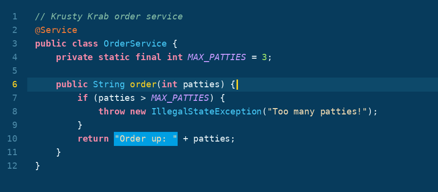
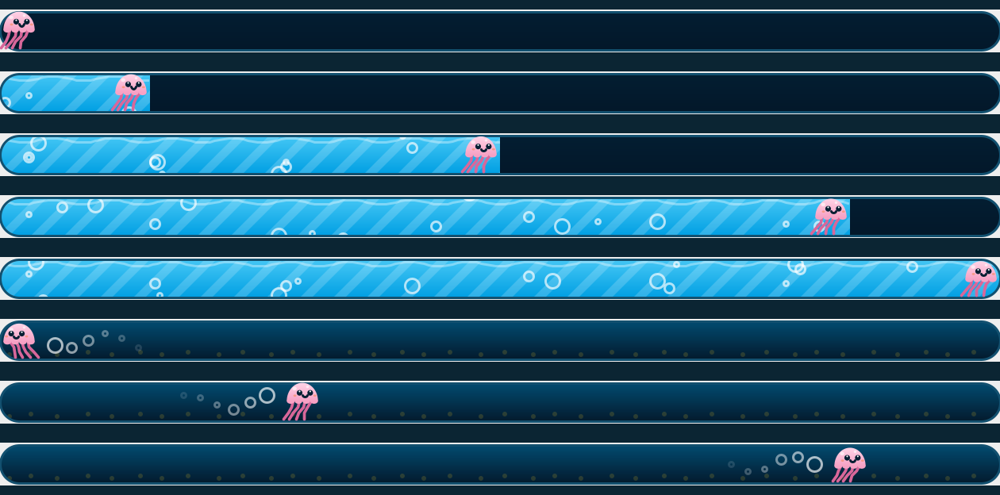
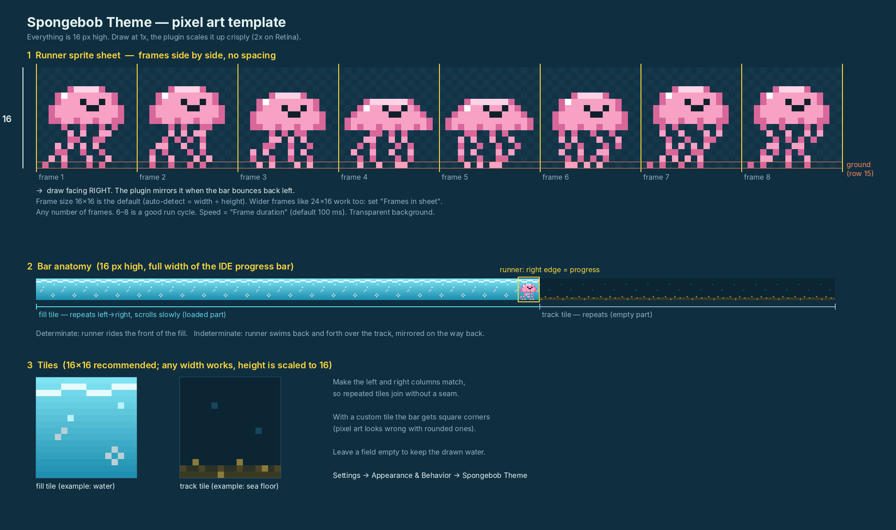

# SpongeBob SquarePants Theme & Progress Bar

A dark, underwater IntelliJ theme inspired by Bikini Bottom, complete with a custom editor colour scheme and an animated progress bar.

Bring a little piece of the ocean into your IDE with deep-sea blues, SpongeBob-yellow highlights, Patrick-pink keywords, and a progress bar that makes waiting a little more fun.

## Features

- **Underwater IDE theme**: A dark interface inspired by the ocean, with deep blues, cyan accents, and SpongeBob's signature yellow.
- **Custom editor colour scheme**: Carefully chosen colours for keywords, functions, strings, annotations, comments, and more.
- **Animated underwater progress bar**: A custom progress bar featuring water, drifting light rays, and bubbles.
- **Custom animated runners**: Replace the default jellyfish with SpongeBob, Patrick, Gary, your own pixel art, or any other character you like.
- **Custom progress bar tiles**: Use your own water and seafloor textures to personalize the loaded and empty portions of the bar.
- **Automatic sprite-sheet detection**: Automatically detect animation frames, including frames with uneven spacing.
- **Live preview**: Preview your custom runner and progress bar directly in the plugin settings.



*The dark underwater editor theme.*



*The animated underwater progress bar.*

## Installation

### Option 1: Install from a release

This is the easiest way to get started.

1. Download the latest plugin ZIP from [GitHub Releases](https://github.com/OumaimaZerouali/Spongebob_themed/releases/latest).
2. Open your IntelliJ-based IDE.
3. Navigate to **Settings → Plugins**.
4. Open the settings menu using the gear icon and select **Install Plugin from Disk…**.
5. Select the downloaded ZIP file and install the plugin.
6. Restart the IDE if prompted.
7. Navigate to **Settings → Appearance & Behavior → Appearance → Theme** and select **Spongebob**.

You're ready to dive into Bikini Bottom!

### Option 2: Build from source

Clone the repository and use the Gradle wrapper to build the plugin or launch a sandbox IDE for testing.

```bash
# Build the plugin
./gradlew buildPlugin

# Launch a sandbox IDE with the plugin installed
./gradlew runIde
```

The generated plugin ZIP is available in:

```text
build/distributions/
```

### Requirements

- IntelliJ-based IDE version **2024.3 or newer**.
- Compatible IDEs include IntelliJ IDEA, WebStorm, PyCharm, and other supported IntelliJ Platform IDEs.

## Customize your progress bar

The progress bar and its animated runner are customizable. You can use the built-in jellyfish or provide your own pixel art, sprite sheet, or animated GIF.

### 1. Prepare your assets

Create a `my-sprites/` directory in the project root, or store your images elsewhere on your machine.

Example directory structure:

```text
spongebob_theme/
└── my-sprites/
    ├── run-sheet.png   # Animated runner sprite sheet or GIF
    ├── fill.png        # Optional: loaded portion of the bar
    └── track.png       # Optional: empty portion of the bar
```

The `my-sprites/` directory is included in `.gitignore`, so your local artwork won't be committed or pushed to the repository by default.

You can use this directory to experiment with different characters and textures without modifying the plugin's built-in assets.

### 2. Configure the plugin

Open:

**Settings → Appearance & Behavior → Spongebob Theme**

Configure the available options:

| Setting | Description |
|---|---|
| **Runner image** | Select a PNG sprite sheet, a single image, or an animated GIF. Leave it empty to use the built-in jellyfish. |
| **Auto-slice** | Enabled by default. Automatically detects animation frames, removes the surrounding background where possible, and handles unevenly spaced frames. Text labels such as "Running" are ignored. |
| **Row / character** | Select an animation row from a multi-row sprite sheet. Available rows are displayed with their detected frame counts, for example, `Row 1 – 8 frames`. |
| **Frame duration** | Controls the animation speed in milliseconds. A value between 70 and 100 ms is a good starting point for a running animation. |
| **Bar height** | Set the height automatically or choose a fixed height of 16, 20, 24, or 32 px. Automatic sizing uses 16 px for typical pixel art and 32 px for larger sprites. |
| **Fill tile** | An optional repeating texture for the loaded portion of the progress bar. |
| **Track tile** | An optional repeating texture for the empty portion of the progress bar. |
| **Grid frames** | An advanced option for defining sprite-sheet frames when automatic slicing is disabled and the frames touch each other. |

After changing your settings, click **Apply** to update the live preview.

If you edit an image externally, click **Apply** again to reload it.

To restore IntelliJ's standard progress bar while keeping the SpongeBob theme and editor colours, disable **Use the underwater progress bar** in the plugin settings.

## Create your own pixel art

The [`templates/`](templates/README.md) directory contains pixel-art specifications, blank canvases, and working examples to help you create your own animated runners and progress bar textures.

You can use tools such as [Aseprite](https://www.aseprite.org/), [LibreSprite](https://libresprite.github.io/), [Piskel](https://www.piskelapp.com/), or [Pixelorama](https://orama-interactive.itch.io/pixelorama).

### Runner sprite sheets

The default runner format uses eight animation frames arranged horizontally.



| Property | Specification |
|---|---|
| Default frame size | 16 × 16 px |
| Sprite-sheet layout | Frames arranged left to right, with no spacing or padding |
| Recommended frame count | 6–8 frames for a running cycle |
| Facing direction | Right |
| Background | Transparent |
| Ground alignment | Bottom row, at `y = 15` |

Draw the runner facing right. The plugin mirrors the animation when the character moves back to the left.

Frames wider than 16 px, such as 24 × 16 px, are also supported. Set **Frames in sheet** to the appropriate number of frames when using the grid-based configuration.

Animated GIFs are supported as well and play as-is without requiring sprite-sheet configuration.

### Progress bar tiles

You can customize the loaded and empty portions of the bar using repeating image tiles.

| Asset | Specification | Purpose |
|---|---|---|
| Fill tile | 16 × 16 px recommended | Repeats over the loaded portion of the bar. |
| Track tile | 16 × 16 px recommended | Repeats over the empty portion of the bar. |

For seamless repetition, ensure that the left and right edges of each tile match.

The plugin scales pixel art using nearest-neighbour scaling, keeping individual pixels crisp when displayed at larger sizes.

Leave either tile unset to use the plugin's default rendering for that portion of the bar.

### Included templates and examples

| File | Description |
|---|---|
| `blank-runner-sheet-8x16x16.png` | Blank canvas for an eight-frame runner. |
| `blank-fill-tile-16.png` | Blank fill-tile canvas. |
| `blank-track-tile-16.png` | Blank track-tile canvas. |
| `example-runner-jellyfish-8f.png` | Example eight-frame animated jellyfish. |
| `example-fill-tile-water.png` | Example underwater fill texture. |
| `example-track-tile-seafloor.png` | Example seafloor track texture. |

To get started, open one of the blank canvases in your preferred pixel-art editor, draw your artwork, export it as a PNG, and select it in the plugin settings.

### Progress bar behaviour

The plugin supports two progress modes:

- **Determinate progress:** The runner moves along the loaded portion of the bar, with its right edge aligned to the current progress.
- **Indeterminate progress:** The runner swims back and forth across the track and is mirrored when moving in the opposite direction.

This allows the animation to work for both tasks with measurable progress and tasks where the completion time is unknown.

## Colour palette

The theme uses an underwater-inspired palette designed to keep the editor readable while retaining the playful character of SpongeBob SquarePants.

| IDE element | Colour | Hex |
|---|---|---|
| Editor background | Deep ocean | `#073B5C` |
| Main UI background | Midnight blue | `#041E32` |
| Current line | Subtle ocean blue | `#0D496A` |
| Selection | Ocean blue | `#009FE3` |
| Caret, functions, accents | SpongeBob yellow | `#FFD521` |
| Keywords | Patrick pink | `#F58AA8` |
| Strings | Sandy beige | `#F5DEB3` |
| Classes and types | Ocean cyan | `#45C7F5` |
| Annotations | Pineapple orange | `#F47B35` |
| Comments | Muted seafoam | `#85BDA6` |
| Errors | Coral red | `#FF6B6B` |
| Numbers | Seaweed green | `#9BE362` |
| Fields and constants | Urchin purple | `#C59BFF` |

## Publishing the plugin (maintainers)

The repository is configured to build and release the plugin through GitHub Actions.

Pushing a version tag in the format `vX.Y.Z` triggers a build and creates a GitHub Release containing the plugin ZIP.

Once the JetBrains Marketplace publishing secrets are configured, the same release workflow can publish the plugin to the Marketplace.

### 1. Generate the signing credentials

Keep signing credentials outside the repository. The `.pem` and `.crt` files should remain excluded from version control.

Generate the encrypted private key:

```bash
openssl genpkey \
  -aes-256-cbc \
  -algorithm RSA \
  -out private_encrypted.pem \
  -pkeyopt rsa_keygen_bits:4096
```

Export the unencrypted private key:

```bash
openssl rsa \
  -in private_encrypted.pem \
  -out private.pem
```

Generate the certificate:

```bash
openssl req \
  -key private.pem \
  -new \
  -x509 \
  -days 3650 \
  -out chain.crt
```

Store the resulting files securely. The unencrypted private key should never be committed to the repository.

### 2. Publish the first release manually

Export the signing credentials as environment variables:

```bash
export CERTIFICATE_CHAIN="$(cat chain.crt)"
export PRIVATE_KEY="$(cat private.pem)"
export PRIVATE_KEY_PASSWORD="your-password"
```

Sign the plugin:

```bash
./gradlew signPlugin
```

The signed ZIP is generated in `build/distributions/`. Upload it through the [JetBrains Marketplace](https://plugins.jetbrains.com/) to publish the initial release.

### 3. Enable automated Marketplace publishing

Configure the following GitHub Actions repository secrets:

| Secret | Description |
|---|---|
| `PUBLISH_TOKEN` | JetBrains Marketplace publishing token, available from Marketplace → Profile → My Tokens. |
| `CERTIFICATE_CHAIN` | Contents of `chain.crt`. |
| `PRIVATE_KEY` | Contents of `private.pem`. |
| `PRIVATE_KEY_PASSWORD` | Password expected by the configured signing task. |

After configuring the secrets:

1. Update `pluginVersion` to the desired release version.
2. Commit and push the changes.
3. Create and push a version tag in the format `vX.Y.Z`.

For example:

```bash
git tag v1.4.0
git push origin v1.4.0
```

A version such as `1.4.0-beta.1` is intended for the beta channel rather than the stable channel.

## Disclaimer

This is an unofficial, non-commercial fan project. It is not affiliated with, sponsored by, or endorsed by Nickelodeon, Paramount, or Viacom.

SpongeBob SquarePants and its associated characters are trademarks and intellectual property of their respective rights holders.

If you are a rights holder and have concerns about this project, please open an issue in the repository.

## Credits

The build setup is based on the [IntelliJ Platform Plugin Template](https://github.com/JetBrains/intellij-platform-plugin-template), licensed under Apache 2.0.

## License

This project is licensed under the [MIT License](LICENSE).
